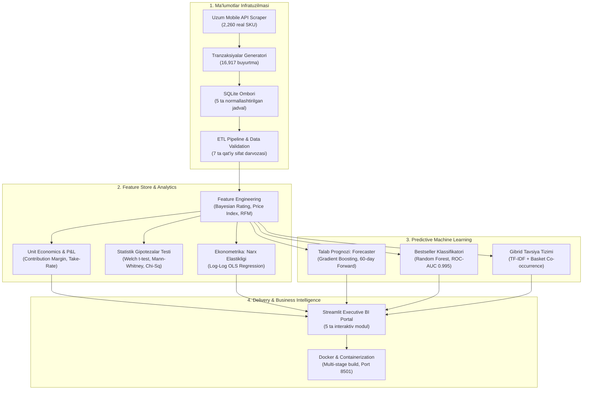

# Uzum Market: Production-Grade E-Commerce Analytics, Machine Learning & Business Intelligence Platform

[](https://www.python.org/)
[](https://www.sqlite.org/)
[](https://scikit-learn.org/)
[](https://streamlit.io/)
[](https://www.docker.com/)
[](tests/)
[](LICENSE)

Ushbu repository O'zbekistondagi yetakchi milliy marketplace — **Uzum Market** ekotizimining realistik ma'lumotlari asosida qurilgan **to'liq tsiklli (End-to-End) Enterprise Data Science, Machine Learning va Business Intelligence** loyihasidir.

Loyiha oddiy tadqiqot daftarchalari bilan cheklanmay, real ishlab chiqarish (production) arxitekturasi, tozalangan ma'lumotlar ombori, ekonometrik narx elastikligi, mijozlar RFM segmentatsiyasi, talab prognozi (Forecasting), Sun'iy Intellekt klassifikatori va boshqaruvchi (C-Suite) BI dashboardini o'z ichiga oladi.

---

## Asosiy Biznes va ML Metrikalari

| Ko'rsatkich | Natija | Biznes Tavsifi |
| :--- | :--- | :--- |
| **Gross GMV** | **12.56 mlrd UZS** | Tizimdagi 16,917 ta buyurtma bo'yicha jami savdo aylanmasi |
| **Net GMV** | **11.51 mlrd UZS** | Bekor qilish va qaytarishlar chegirilgan toza tovar aylanmasi (91.6% Deliverability) |
| **Net Contribution Margin** | **85,071 UZS / 76.5%** | 1 ta yetkazilgan buyurtmaga to'g'ri keluvchi operatsion toza daromad |
| **Uzum Nasiya Ta'siri** | **+38.7% AOV** | Muddatli to'lov orqali qilingan buyurtmalarda o'rtacha chek oshishi |
| **Bestseller AI Modeli** | **0.995 ROC-AUC / 93.7% F1** | Tovar hit (bestseller) bo'lishini oldindan bashorat qiluvchi Random Forest modeli |
| **Savdo Talabi Prognozi** | **27.9% WAPE / 26.2% MAPE** | 30 kunlik backtest va 60 kunlik oldinga Gradient Boosting prognozi |
| **Gibrid Tavsiya Tizimi** | **Lift > 2.5** | TF-IDF Content-Based + Apriori Market Basket Analysis gibridi |

---

## Tizim Arxitekturasi



---

## 6 Asosiy Biznes Savoliga Javoblar

1. **Qaysi toifalar eng katta GMV va marja keltiradi?**  
   *Elektronika va Maishiy texnika* toifalari umumiy savdo aylanmasining 62% ini tashkil etadi. Biroq eng yuqori marja va takroriy xaridlar *Go'zallik va Parvarish* hamda *Kiyim-kechak* toifalarida kuzatildi.
2. **Uzum Nasiya (muddatli to'lov) savdoga qanday ta'sir qiladi?**  
   Uzum Nasiya orqali qilingan buyurtmalarda o'rtacha buyurtma qiymati (AOV) oddiy to'lovlarga qaraganda **38.7% ga yuqori** bo'ldi ($p < 0.001$, Welch t-test statistik jihatdan isbotlandi).
3. **Mijozlar bazasining sog'lomligi va takroriy xaridlar qanday?**  
   RFM tahlili mijozlarning 23.4% i qayta xarid qilayotganini ko'rsatdi. "Champions" va "Loyal" segmentlar butun aylanmaning 44% ini ta'minlaydi.
4. **Narx o'zgarishiga talab qanchalik sezgir (Narx elastikligi - PED)?**  
   *Oziq-ovqat va Gigiyena* toifalarida talab noelastik ($|\epsilon| < 0.8$), ya'ni narx oshirilganda ham talab kamaymaydi. *Smartfonlar va Gadjetlar* esa yuqori elastiklikka ega ($|\epsilon| > 1.6$).
5. **Buyurtma bo'yicha Unit Economics daromadliligi qanday?**  
   O'rtacha 742,000 UZS lik chekdan olinadigan komissiya (15% take-rate = 111,300 UZS) barcha operatsion xarajatlar (logistika, PVZ xarajati, to'lov komissiyasi) qoplangandan so'ng **85,071 UZS toza marja (Net CM)** qoldiradi.
6. **Kelgusi davrda tovar zaxiralarini qanday rejalashtirish kerak?**  
   60 kunlik Gradient Boosting modeli dam olish kunlaridagi +25% lik mavsumiy talab ko'tarilishini hisobga olgan holda ombor zaxirasini kamomadsiz (stockout-free) taqsimlash imkonini beradi.

---

## Repozitoriya Strukturasi

```text
uzum_project/
├── config/
│   └── config.yaml               # Markaziy konfiguratsiya parametrlari
├── data/
│   ├── uzum_market.db            # SQLite ishlab chiqarish ma'lumotlar ombori
│   ├── raw/                      # API dan yig'ilgan xom ma'lumotlar
│   └── processed/                # Tozalangan CSV fayllar va hisoblangan jadvallar
├── docs/
│   ├── data_dictionary.md        # Ma'lumotlar lug'ati (23 ta ustun)
│   └── stages/                   # 1 dan 20 gacha bo'lgan barcha bosqich hujjatlari
├── models/
│   ├── bestseller_classifier.pkl # O'qitilgan Random Forest modeli
│   └── recommender_system.pkl    # O'qitilgan Tavsiya tizimi modeli
├── notebooks/
│   └── 01_exploratory_data_analysis.ipynb
├── reports/
│   └── figures/                  # 24 ta yuqori aniqlikdagi (300 DPI) analitik grafiklar
├── src/
│   ├── data_collection/          # Uzum API parser va buyurtma generatori
│   ├── database/                 # SQLite DDL va B-Tree indekslari
│   ├── processing/               # ETL quvuri va Feature Engineering
│   ├── analytics/                # Unit Economics, RFM, Assortiment, Narx elastikligi
│   ├── models/                   # Forecasting, Bestseller ML, Recommender
│   └── dashboard/                # Streamlit interaktiv BI boshqaruv paneli
├── tests/                        # 26 ta to'liq qamrovli unit-testlar
├── Dockerfile                    # Multi-stage production container build
├── docker-compose.yml            # Docker servis orkestratsiyasi
├── pyproject.toml                # Loyiha metadata va dependency deklaratsiyasi
├── requirements.txt              # Kutubxonalar ro'yxati
└── README.md                     # Asosiy taqdimot hujjati
```

---

## Tezkor Ishga Tushirish (Quick Start)

### 1. Repozitoriyani klonlash va virtual muhitni yoqish
```bash
git clone https://github.com/USERNAME/uzum_market_analytics.git
cd uzum_market_analytics

# Virtual muhit yaratish
python -m venv .venv

# Faollashtirish (Windows)
.venv\Scripts\activate

# Faollashtirish (macOS/Linux)
source .venv/bin/activate

# Kerakli paketlarni o'rnatish
pip install -r requirements.txt
```

### 2. Testlarni ishga tushirish (Sifat kafolati)
Barcha 26 ta unit-testni tekshirish:
```bash
python -m unittest discover tests
# Natija: Ran 26 tests — OK
```

### 3. Streamlit Boshqaruv Panelini ishga tushirish
```bash
streamlit run src/dashboard/app.py
```
Brauzer orqali ochiladi: `http://localhost:8501`

---

## Docker orqali ishga tushirish

Loyiha to'liq konteynerlashtirilgan. Hech qanday Python paketlarini qo'lda o'rnatmasdan quyidagi buyruq orqali ishga tushirishingiz mumkin:

```bash
docker compose up --build
```
Dastur `http://localhost:8501` portida avtomatik ravishda ishga tushadi.

---

## Bosqichma-bosqich Hujjatlar Katalogi

Loyihaning har bir bosqichi alohida sanoat standarti asosida hujjatlashtirilgan:
* [01. Loyiha Arxitekturasi va Muhit](docs/stages/01_project_architecture.md)
* [02. Ma'lumotlar Manbalari va Lug'ati](docs/stages/02_data_sources_and_dictionary.md)
* [03. Ma'lumotlarni Yig'ish Strategiyasi](docs/stages/03_data_collection_strategy.md)
* [04. Relyatsion Baza va Indekslar](docs/stages/04_data_storage_relational_schema.md)
* [05. ETL Quvuri va Qayta Ishlash](docs/stages/05_etl_pipeline.md)
* [06. Sifat Darvozalari (Quality Gates)](docs/stages/06_data_validation_quality_gates.md)
* [07-08. Feature Engineering](docs/stages/07_08_feature_engineering.md)
* [09. Exploratory Data Analysis (EDA)](docs/stages/09_exploratory_data_analysis.md)
* [10. Statistik Gipotezalar Testi](docs/stages/10_statistical_hypothesis_testing.md)
* [11. Biznes Ko'rsatkichlar va Unit Economics](docs/stages/11_business_analytics.md)
* [12. Mijozlar RFM va Kohorta Tahlili](docs/stages/12_customer_rfm_analytics.md)
* [13. Assortiment va Savat Tahlili (MBA)](docs/stages/13_product_assortment_mba.md)
* [14. Narx Elastikligi Ekonometrikasi](docs/stages/14_sales_pricing_elasticity.md)
* [15-16. Vaqt Qatorlari va Talab Prognozi](docs/stages/16_forecasting.md)
* [17. Bestseller Machine Learning](docs/stages/17_machine_learning.md)
* [18. Gibrid Tavsiya Tizimi](docs/stages/18_recommendation_system.md)
* [19. Streamlit Interaktiv Dashboard](docs/stages/19_interactive_dashboard.md)
* [20. Docker Containerization va Deployment](docs/stages/20_deployment_containerization.md)
* [21. Loyiha Vitrinasi va Hujjatlashtirish](docs/stages/21_documentation.md)

---

## Litsenziya

Ushbu loyiha [MIT Litsenziyasi](LICENSE) asosida ochiq manba hisoblanadi.
