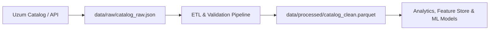

# 📖 Uzum Market Data Dictionary & Schema Specification

Ushbu hujjat Uzum Market platformasidan yig'iladigan va tahlil qilinadigan barcha ma'lumotlar ustunlari, ularning texnik turlari, biznes talqini va sifat mezonlarini belgilab beradi.

---

## 1. Asosiy Entitiylar va Ustunlar Jadvali

| Ustun Nomi | Ma'lumot Turi | Nullable? | Tavsif (Biznes Talqini) | Misol Qiymat | Validatsiya Qoidasi |
| :--- | :--- | :--- | :--- | :--- | :--- |
| `product_id` | `INT64` / `STRING` | Yo'q | Mahsulotning unikal identifikatori (SKU) | `1048576` | Bo'sh bo'lmasligi, takrorlanmasligi kerak |
| `title` | `STRING` | Yo'q | Mahsulotning to'liq savdo nomi | `Smartfon Xiaomi Redmi Note 13 8/256GB` | Uzunligi kamida 3 belgi |
| `category_id` | `INT64` | Yo'q | Mahsulot biriktirilgan eng quyi toifa IDsi | `1245` | Mavjud toifalar ro'yxatida bo'lishi shart |
| `category_name` | `STRING` | Yo'q | Eng quyi toifa nomi | `Smartfonlar` | Bo'sh bo'lmasligi kerak |
| `category_path` | `STRING` | Ha | Toifaning to'liq iyerarxiya yo'li | `Elektronika > Smartfonlar va telefonlar > Smartfonlar` | `>` bilan ajratilgan |
| `seller_id` | `INT64` | Yo'q | Sotuvchi (do'kon) unikal IDsi | `88412` | Manfiy bo'lmasligi kerak |
| `seller_name` | `STRING` | Yo'q | Do'konning rasmiy nomi | `Xiaomi Official Store UZ` | Bo'sh bo'lmasligi kerak |
| `seller_rating` | `FLOAT32` | Ha | Do'konning umumiy reytingi | `4.85` | `[1.0, 5.0]` oralig'ida |
| `price_current` | `INT64` | Yo'q | Xaridor to'laydigan yakuniy narx (so'mda) | `2650000` | `> 0` |
| `price_original` | `INT64` | Ha | Chegirmagacha bo'lgan narx (so'mda) | `3200000` | `price_original >= price_current` |
| `discount_percentage` | `FLOAT32` | Ha | Asl narxga nisbatan chegirma ulushi (%) | `17.18` | `[0.0, 100.0]` oralig'ida |
| `monthly_installment` | `INT64` | Ha | Muddatli to'lov (Uzum Nasiya) oylik to'lovi (so'mda) | `220833` | `>= 0` |
| `installment_period_months` | `INT16` | Ha | Muddatli to'lov standarti (oylar soni) | `12` | Masalan: 3, 6, 12, 24 |
| `has_installment` | `BOOLEAN` | Yo'q | Muddatli to'lov / nasiya imkoniyati mavjudligi | `True` | `True` yoki `False` |
| `delivery_time_days` | `INT16` | Ha | Xaridorga yetkazish vaqti (kunlarda) | `1` | `>= 0` (0: shu kunning o'zida, 1: ertaga) |
| `delivery_type` | `STRING` | Ha | Yetkazib berish usuli | `PVZ` / `Courier` / `Express` | Ruxsat etilgan turlar ro'yxatida bo'lishi |
| `rating` | `FLOAT32` | Ha | Mahsulotning xaridorlar bergan o'rtacha bahosi | `4.9` | `[0.0, 5.0]` oralig'ida |
| `reviews_count` | `INT32` | Yo'q | Mahsulotga qoldirilgan sharhlar soni | `1420` | `>= 0` |
| `orders_count` | `INT32` | Yo'q | Sotib olingan / buyurtma qilinganlar soni | `5400` | `>= 0` |
| `is_eco` | `BOOLEAN` | Yo'q | Eko-mahsulot belgisi borligi | `False` | `True` yoki `False` |
| `is_adult` | `BOOLEAN` | Yo'q | 18+ toifasiga tegishliligi | `False` | `True` yoki `False` |
| `in_stock` | `BOOLEAN` | Yo'q | Omborda tovar mavjudligi holati | `True` | `True` yoki `False` |
| `crawled_at` | `TIMESTAMP` | Yo'q | Ma'lumot skaner qilingan aniq sana va vaqt | `2026-10-19 18:00:00` | UTC vaqt formati (ISO 8601) |

---

## 2. Biznes Qoidalari va Alohida Ahamiyatga Ega Mantiqlar

### A. Muddatli To'lov (Uzum Nasiya)
O'zbekiston e-commerce bozorida aylanmaning 40-60% gacha bo'lgan qismi muddatli to'lov (BNPL - Buy Now Pay Later) orqali amalga oshiriladi.
- Agar mahsulotda `has_installment == True` bo'lsa, xaridorning to'lov qobiliyati chegarasi (affordability) keskin oshadi.
- Bu belgi narx elastikligi va savdo tezligiga to'g'ridan-to'g'ri ta'sir ko'rsatuvchi muhim omil (feature) hisoblanadi.

### B. Yetkazib Berish Tezligi (`delivery_time_days`)
Uzum Marketning asosiy raqobat ustunligi — 1 kunda viloyat markazlaridagi topshirish punktlariga (PVZ) yetkazib berishdir.
- `delivery_time_days == 1` tovar konversiyasini 30-50% ga oshiradi.
- Tashqi sotuvchilardan (Marketplace FBS) yetkaziladigan tovarlar 3-5 kun vaqt olishi mumkin.

---

## 3. Data Lineage (Ma'lumotlar Oqimi)

