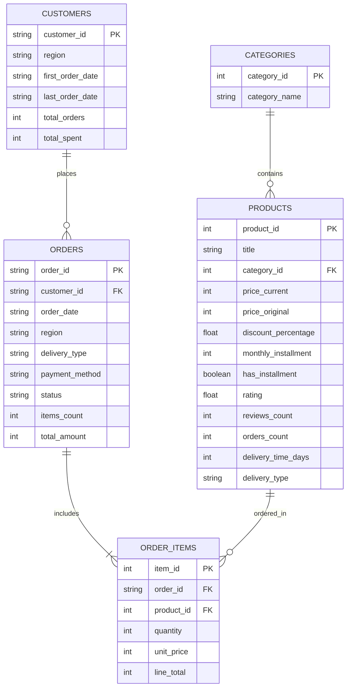

# Stage 04: Data Storage & Relational Database Architecture

> **Kategoriya:** Database Engineering & Schema Design  
> **Status:** Muvaffaqiyatli yakunlandi ✅  
> **Modul:** `src/database/schema.py`  
> **Ma'lumotlar bazasi:** `data/uzum_market.db` (SQLite 3)

---

## 1. Muammo va Arxitektura Qarori

Katta hajmdagi JSON fayllar bilan bevosita tahlil olib borish bir qator cheklovlarga ega:
- Takroriy ma'lumotlar (redunancy) xotirani behuda sarflaydi.
- relyatsion bog'lanishlar (Primary Key, Foreign Key) ta'minlanmaydi.
- Filtrlash va agregatsiya operatsiyalari sekin kechadi.

Ushbu muammoni hal qilish uchun relyatsion normallashtirish (3NF ga yaqin) va analitik indekslash tamoyillari asosida ma'lumotlar bazasi qurildi.

---

## 2. Relyatsion Sxema va Entity Relationship Diagram (ERD)

---

## 3. Indekslash va Performance Optimallashtirish

Tahliliy so'rovlar millisekundlarda ishlashi uchun quyidagi 8 ta B-Tree indekslar yaratildi:
- `idx_products_category`, `idx_products_price`
- `idx_orders_customer`, `idx_orders_date`, `idx_orders_region`, `idx_orders_payment`
- `idx_order_items_order`, `idx_order_items_product`

---

## 4. Web Sayt / Portfolio Showcase uchun Xulosalar

- **Pitch:** "Xom e-commerce ma'lumotlari 5 ta o'zaro bog'langan relyatsion jadvalga normallashtirildi va analitik so'rovlar uchun 8 ta B-Tree indeks bilan tezlashtirildi."
- **Key Metrics:** 5 ta relyatsion jadval, 8 ta optimallashgan indeks, 0 orphan records (to'liq yaxlitlik).
