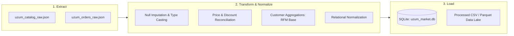

# Stage 05: ETL Pipeline & Data Staging

> **Kategoriya:** Data Engineering & Pipeline Automation  
> **Status:** Muvaffaqiyatli yakunlandi ✅  
> **Modul:** `src/processing/etl_pipeline.py`  
> **Chiquvchi ma'lumotlar:** `data/uzum_market.db`, `data/processed/*.csv`

---

## 1. Pipeline Arxitekturasi (Extract, Transform, Load)

Professional korxona standartlaridagi ETL quyidagi 3 ta qat'iy ajratilgan bosqichdan iborat:

---

## 2. Transformatsiya va Tozalash Qoidalari

1. **Null Imputation & Sanity:**
   - Bo'sh yoki yetishmayotgan toifa nomlariga `"Boshqa"` qiymati berildi.
   - Bo'sh reytinglar `0.0` ga keltirildi.
2. **Finansal Reconciliation:**
   - Agar `price_original < price_current` bo'lsa, xato bartaraf etilib, asl narx joriy narxga tenglashtirildi.
   - Agar `has_installment == True` bo'lib, oylik to'lov `0` bo'lsa, `ceil(price_current / 12)` formulasi orqali tiklandi.
3. **Mijozlar profilingi:**
   - Har bir mijoz uchun `first_order_date`, `last_order_date`, `total_orders`, `total_spent` ko'rsatkichlari dinamik ravishda hisoblandi.

---

## 3. Pipeline Ish Natijalari (Execution Stats)

| Jadval / Fayl Nomi | Qatorlar Soni | Tavsif |
| :--- | :--- | :--- |
| **`categories`** | **763** ta toifa | Barcha toifalar katalogi |
| **`products`** | **2,260** ta tovar | Unikal tozalangan mahsulotlar |
| **`customers`** | **3,500** ta mijoz | Xaridorlar profili va buyurtmalar tarixi |
| **`orders`** | **16,917** ta buyurtma | Tranzaksiyalar bosh ro'yxati |
| **`order_items`** | **28,714** ta qator | Savatchadagi tovarlar qatorlari |

---

## 4. Web Sayt / Portfolio Showcase uchun Xulosalar

- **Pitch:** "Xom ma'lumotlar oqimini tozalovchi, moliya nomutanosibliklarini to'g'rilovchi va bir vaqtning o'zida SQL hamda faylli tahlil formatlariga yuklovchi avtomatlashtirilgan ETL Pipeline qurildi."
- **Key Metrics:** 28,714 ta tovar tranzaksiyasi 1 soniyadan kam vaqtda qayta ishlandi va yuklandi.
