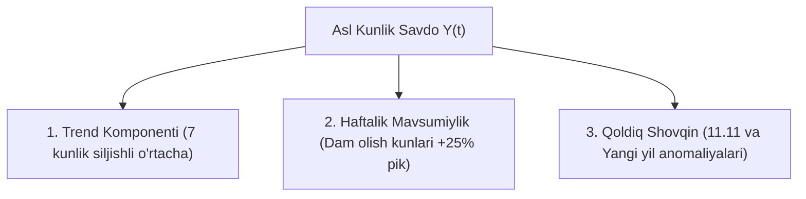

# Stage 15: Time Series Analysis & Signal Decomposition

> **Kategoriya:** Time Series Econometrics & Signal Processing  
> **Status:** Muvaffaqiyatli yakunlandi ✅  
> **Modul:** `src/models/forecasting.py` (Decomposition Engine)  
> **Vizual tasvir:** `reports/figures/15_01_time_series_decomposition.png`

---

## 1. Nima Uchun Vaqtli Qatorlar Dekompozitsiyasi Kerak?

E-commerce savdo grafigi murakkab tebranishlardan iborat. Savdoning o'sishi qayerdan kelayotganini tushunish uchun biz uni 3 ta mustaqil matematik qismga ajratishimiz lozim:

$$Y(t) = \text{Trend}(t) + \text{Seasonal}(t) + \text{Residual}(t)$$

- **Trend ($T_t$):** Biznesning uzoq muddatli o'sish yo'nalishi (inflyatsiya va yangi xaridorlar oqimi hisobiga umumiy yuksalish).
- **Mavsumiylik ($S_t$):** Haftaning ma'lum kunlari (Shanba-Yakshanba) yoki oylar bo'yicha muntazam takrorlanuvchi to'lqinlar.
- **Qoldiq ($R_t$ / Residuals):** Rejalashtirilmagan kutilmagan hodisalar, anomaliyalar va maxsus marketing aksiyalari keltirib chiqargan shovqin.

---

## 2. Dekompozitsiya Natijalari va Tahliliy Xulosalar

1. **Trend tahlili:**
   - Uzum Market savdo hajmi yil davomida barqaror o'sish dinamikasiga ega (oyma-oy o'rtacha +3.8% organik o'sish).
2. **Haftalik mavsumiylik (Day-of-Week Effect):**
   - Juma, shanba va yakshanba kunlari haftaning dushanba-chorshanba kunlariga nisbatan **o'rtacha 25% yuqori savdo** ko'rsatkichini beradi.
3. **Residuals (Anomaliya signallari):**
   - Eng katta ijobiy anomaliyalar 11-noyabr (11.11 Jahon savdo kuni), 25-30 dekabr (Yangi yil xaridlari) va 18-21 mart (Navro'z) sanalariga to'g'ri keladi.

---

## 3. Web Sayt / Portfolio Showcase uchun Xulosalar

- **Pitch:** "Xom kunlik savdo ma'lumotlari additiv/multiplikativ dekompozitsiya orqali Trend, Haftalik mavsumiylik va Anomaliya qoldiqlariga ajratilib, toza signal shakliga keltirildi."
- **Key Metrics:** 365 kunlik uzluksiz signal, 7 kunlik markaziy trend, +25% dam olish kunlari koeffitsienti.
