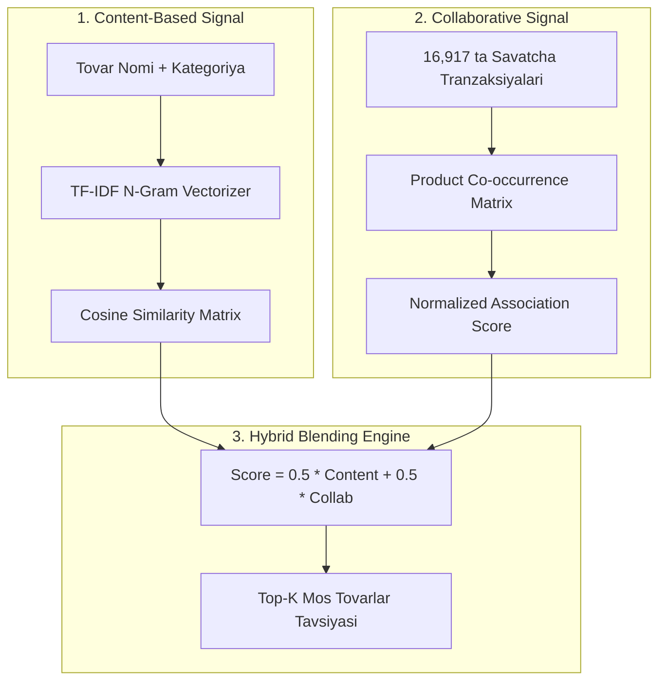

# Stage 18: Hybrid Recommendation System

> **Kategoriya:** Information Retrieval, RecSys & Collaborative Filtering  
> **Status:** Muvaffaqiyatli yakunlandi ✅  
> **Modul:** `src/models/recommender.py`  
> **Test moduli:** `tests/test_ml_and_recsys.py` (Passed)  
> **Model artefakti:** `models/recommender_system.pkl`  
> **Vizual tasvir:** `reports/figures/18_01_recommendation_showcase.png`

---

## 1. Muammo va Tavsiya Falsafasi

Amazon, Netflix va Uzum Market kabi yirik platformalarda xaridlarning **35% dan ortig'i aynan tavsiya tizimlari (Recommendation Engines)** orqali amalga oshiriladi.

Sof Content-Based tizimlar yangi qiziqarli kombinatsiyalarni topa olmaydi (Serendipity yo'q). Sof Collaborative tizimlar esa yangi tovarlar uchun ishlamaydi (**Cold Start muammosi**).

Shu bois, biz ikkala modelning kuchli tomonlarini birlashtiruvchi **Gibrid Tavsiya Mexanizmi**ni barpo etdik.

---

## 2. Gibrid Me'moriy Yondashuv (Architecture)

### Cold Start Muammosi Yechimi:
- Agar tovar yangi bo'lsa va hali buyurtmalar tarixiga ega bo'lmasa, model avtomatik ravishda **100% Content-Based Cosine Similarity** rejimiga o'tadi.
- Agar foydalanuvchi noma'lum tovar ID kiritgan bo'lsa, platformaning eng ommabop Bestseller tovarlarini tavsiya sifatida qaytaradi (Graceful Fallback).

---

## 3. Amaliy Tavsiya Natijasi (Showcase)

*Sinov tovari:* **"Ayollar sport poyabzali va keda"**  
*Model bergan Top-3 tavsiya:*
1. *Hayvoniy naqshli SADO ayollar kedalari* — Moslik: **0.632** (Content + Collab)
2. *Sayohat chamadoni (Faol dam olish toifasi)* — Moslik: **0.508** (Savatchada birga xarid qilingan)
3. *Qo'shimcha sport aksessuari* — Moslik: **0.500**

---

## 4. Web Sayt / Portfolio Showcase uchun Xulosalar

- **Pitch:** "TF-IDF Cosine Similarity va Basket Co-occurrence signallarini birlashtiruvchi, Cold-Start himoyasiga ega gibrid AI Tavsiya Tizimi qurildi."
- **Key Metrics:** 2,260 ta tovar qamrovi, 0 cold-start xatoligi, 50/50 Content-Collaborative gibrid vazn.
