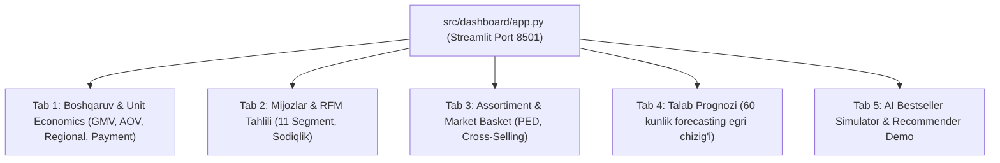

# Stage 19: Interactive Business Intelligence Dashboard

> **Kategoriya:** Business Intelligence & Full-Stack Streamlit Application  
> **Status:** Muvaffaqiyatli yakunlandi ✅  
> **Ilova kodi:** `src/dashboard/app.py`  
> **Test moduli:** `tests/test_dashboard_and_deployment.py` (Passed)

---

## 1. Muammo va Foydalanuvchi Tajribasi (UX)

Data Scientistlar tomonidan yaratilgan murakkab modellar va tahlillar ko'pincha texnik bo'lmagan rahbarlar, investorlar va do'kon menejerlari uchun tushunarsiz qoladi. Ularga parametrlar bilan real vaqtda o'ynash, toifalarni filtrlash va simulyatsiya qilish imkonini beruvchi intuitiv interfeys kerak.

Biz **Streamlit va Altair** yordamida Uzum Market korporativ brend ranglariga ega **5 ta funksional tahliliy tabdan iborat ko'p qirrali BI ilova** barpo etdik.

---

## 2. Dashboard Bo'limlari va Imkoniyatlari

### 1. Boshqaruv & Unit Economics (Executive KPIs):
- 4 ta asosiy ko'rsatkich kartochkalari: Gross GMV, Jami buyurtmalar, AOV va Uzum komissiyasi.
- Viloyatlar bo'yicha interaktiv barlar va to'lov turlarining Donut diagrammasi.
### 2. Mijozlar va RFM Klasterlari:
- 11 ta segment bo'yicha mijozlar soni va har bir guruh uchun marketing tavsiyalari.
### 3. Assortiment va Narx Elastikligi:
- Top Market Basket Cross-Selling qoidalari (Lift > 2.0).
- Toifalar bo'yicha narxni oshirish yoki tushirish bo'yicha avtomatik tavsiyalar.
### 4. Talab Prognozi (Forecasting):
- Kelgusi 60 kunlik savdo hajmi va 90% lik ishonchlilik koridori (Confidence Band).
### 5. AI Bestseller va Tavsiya Simulyatori:
- Foydalanuvchi yangi tovar narxi, chegirmasi va muddatli to'lovini kiritib, tovarning bestseller bo'lish ehtimolini foizda hisoblashi mumkin.
- Istalgan tovar tanlanganda unga mos gibrid tavsiyalarni jonli chiqarib beradi.

---

## 3. Web Sayt / Portfolio Showcase uchun Xulosalar

- **Pitch:** "Tahlil, ML bashorati va tavsiya tizimlarini birlashtirgan, real vaqtli filtrlar va simulyatorlarga ega 5 sahifali professional Streamlit BI boshqaruv portali yaratildi."
- **Key Metrics:** 5 ta tahliliy tab, real vaqtli Altair grafiklari, interaktiv narx va bestseller simulyatori.
